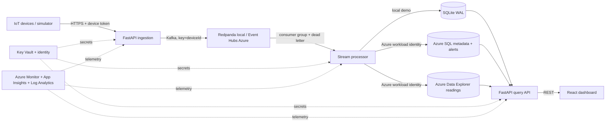

# Metrovale Architecture

## Requirements

Accept timezone-aware readings for AQI, PM2.5, temperature, humidity, and noise; validate device IDs, units, and ranges; buffer events durably; deduplicate and evaluate thresholds; store device metadata separately from time-series readings; and expose filters, bounded history, health, and alerts to city operators.

Ingestion returns only after broker acknowledgement. Processing is at-least-once with an idempotent event key. Read endpoints cap pages and history to 30 days. Human login is outside this demo; device tokens and service identities protect service boundaries.

## Flow

## Azure target

AKS runs the four containerized services; ACR stores versioned images. Event Hubs Standard exposes Kafka protocol. Azure SQL is the intended device/location/threshold registry. ADX stores high-volume readings, window aggregates, and anomalies. Key Vault stores credentials; hosted services should use managed identity/workload identity and least privilege. Log Analytics, Application Insights, Azure Monitor, and a resource-group budget support operation and cost governance.

AKS nodes, the public dashboard load balancer, and ADX can exceed $50-$200/month when left running. The dashboard is public in the demo chart; API and ingestion services are internal. Use the cost review and destroy after the demo.

## Reliability and trade-offs

Local Redpanda and SQLite make development repeatable without Azure credentials. The worker commits offsets after the write path; invalid events are routed to a dead-letter topic. Event ID plus device ID is the SQL uniqueness key. Broker failures return 503 rather than acknowledging lost data. Azure SQL/ADX are separate data stores, so there is no cross-store transaction; replay and query deduplication are required after partial failures.

The current worker provides continuous Kafka consumption and threshold processing but not Flink runtime checkpoints or event-time windows. Do not describe it as a Flink cluster. The Azure SQL/ADX adapter requires the documented SQL and KQL bootstrap scripts before first use.
